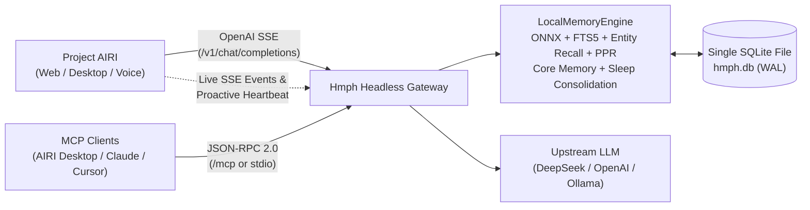

# Hmph

**Local memory for [Project AIRI](https://github.com/moeru-ai/airi) and MCP agents.**

<p>
  <strong>English</strong> | <a href="README_CN.md">简体中文</a>
</p>

[](https://www.python.org/)
[](LICENSE)
[](docs/architecture.md)
[](integrations/airi/README.md)

Hmph keeps memory across chats in a single SQLite database. If you move a piano session from Saturday to Monday, the current plan changes and the original wording stays in the history. AIRI still supplies the character and the interface.

## What Hmph does

- Tracks plans, preferences, and other facts as source-linked changes. You can ask what changed, what is current, or what was recorded before.
- Finds relevant conversation history with full-text search, vectors, and links between related records. Each reply gets a small selection of that evidence.
- Handles new messages in receipt order. If an extraction reply repeatedly has invalid structure, the queue isolates that message and keeps processing later ones.
- Runs as a streaming chat gateway or an MCP server. Characters can use separate namespaces, and memory can be exported to JSON or Markdown.

## Architecture



Read the full technical deep dive in [docs/architecture.md](docs/architecture.md).

---

## Quickstart for Project AIRI

Use Python 3.12 or 3.13. Clone the repository or download a source archive from GitHub.

```bash
git clone https://github.com/knoci/Hmph.git
cd Hmph
python -m pip install .
```

Install with `python -m pip install ".[embeddings]"` to enable the optional local embedding dependencies. The base installation can use hashing vectors alongside full-text search.

### Configure an upstream model

Copy `.env.example` to `.env.local`, then set your provider credentials and model. The following uses DeepSeek Flash.

```env
HMPH_DEEPSEEK_API_KEY=your-key
HMPH_DEEPSEEK_MODEL=deepseek-flash
```

**Other model providers**

Set all three overrides in `.env.local` and restart Hmph. Use the API key and a Chat Completions model ID from the same provider. For example, with an Ollama model already installed:

```env
HMPH_LOCAL_API_KEY=ollama
HMPH_LOCAL_BASE_URL=http://127.0.0.1:11434/v1
HMPH_LOCAL_MODEL=qwen3:8b
```

- **Self-hosted** — Use the server's OpenAI-compatible base URL and served model ID. For vLLM, a chat template is required. [Ollama](https://docs.ollama.com/api/openai-compatibility) · [vLLM](https://docs.vllm.ai/en/latest/serving/online_serving/)
- **Gemini API** — Use `https://generativelanguage.googleapis.com/v1beta/openai/`. [Google docs](https://ai.google.dev/gemini-api/docs/openai)
- **Claude API** — Use `https://api.anthropic.com/v1` and a workspace-scoped API key. Hmph uses Claude's default sampling and validates extraction JSON locally. [Anthropic docs](https://platform.claude.com/docs/en/cli-sdks-libraries/libraries/openai-sdk)
- **Grok API** — Use `https://api.x.ai/v1` with a model available through Chat Completions. [xAI docs](https://docs.x.ai/developers/rest-api-reference/inference/chat-completions)

AIRI still connects to Hmph and can use `hmph` as the model. Each Hmph process uses one upstream URL and credential. A new model should pass a streaming reply and a save–update–recall check before you rely on it for memory.

With `HMPH_LOCALE=auto`, memory prompts follow English and Chinese conversation and the CLI uses English. Use `en` or `zh` to set both explicitly. Set `HMPH_SOURCE_TIMEZONE` independently to control how relative dates are interpreted.

DeepSeek Flash was exercised with live requests in English and Chinese through the gateway. The Ollama, vLLM, Gemini, Claude, and Grok configurations were exercised with simulated upstream responses. Unicode tokenization and the optional multilingual encoder also cover scripts such as kana, Hangul, Cyrillic, and accented Latin.

When opening a database with older full-text indexes, Hmph rebuilds them from stored records. Older hashing vectors are refreshed when the hashing backend is active. Messages that produce three invalid extraction responses are isolated so the queue can continue. Provider failures leave messages pending.

### Start the gateway

```bash
hmph airi-gateway --db data/hmph.db --port 8018
```

### Connect AIRI

In **AIRI → Settings → Providers → OpenAI Compatible**:

| Setting | Value |
| :--- | :--- |
| **Base URL** | `http://127.0.0.1:8018/v1` |
| **API Key** | `local-hmph` for an unauthenticated local gateway. Use the configured gateway key when authentication is enabled. |
| **Model** | Choose one of the formats below (type manually or fetch `hmph` from `/v1/models`) |

**How `Model` routing works** (controls both the isolated memory namespace and the upstream LLM):

| `Model` Value | Memory Namespace | Upstream LLM Used | Best For |
| :--- | :--- | :--- | :--- |
| `hmph` | `default` | Default model from `.env.local` | **Simplest setup** — single AIRI companion |
| `hmph/<character>`<br>*(e.g. `hmph/yuki`, `hmph/airi`)* | `<character>` (strictly isolated) | Default model from `.env.local` | **Multi-character isolation** — keep separate characters' memories in one `.db` file without cross-talk |
| `hmph/<character>@<upstream_model>`<br>*(e.g. `hmph/yuki@deepseek-flash`)* | `<character>` (strictly isolated) | Explicit model after `@` | **Per-character model override** — use a different upstream LLM per AIRI profile without restarting Hmph |
| Raw upstream model name<br>*(e.g. `deepseek-flash`, `gpt-4o-mini`)* | `default` (or `X-Hmph-Namespace` header) | The exact model name you entered | Clients that expect a standard provider model ID while still using default memory |

> Tip: `hmph:<character>` and `airi/<character>` are also accepted. If the `X-Hmph-Namespace` header is present, it takes precedence over the model prefix.

### Try a memory update

Tell AIRI “I’m practicing piano on Saturday,” then “Move piano practice to Monday.” Start a new chat in the same memory namespace and ask “When am I practicing piano?” The expected answer is Monday. To inspect the stored state and its evidence, use `GET /v1/memory` and `POST /v1/memory/recall`.

See [integrations/airi/README.md](integrations/airi/README.md) for custom headers (`X-Hmph-Namespace`, `X-Hmph-Session-Id`, `X-Hmph-Memory-Mode`), SSE Live2D hooks, and proactive check-ins.

---

## MCP Server (8 Tools)

Mount Hmph in AIRI Desktop, Claude Desktop, or Cursor using [integrations/airi/mcp-config.json](integrations/airi/mcp-config.json):

```json
{
  "mcpServers": {
    "hmph-memory": {
      "command": "hmph",
      "args": ["local-mcp", "--db", "data/hmph.db"]
    }
  }
}
```

Or talk directly to the running gateway over Streamable HTTP at `POST http://127.0.0.1:8018/mcp`.

Exposed MCP tools:
- `hmph_remember` — Store verbatim text and extract changes to memory
- `hmph_recall` — 6-channel hybrid recall (Core Memory + ONNX + FTS5 + Entity-Scoped + Bipartite PPR)
- `hmph_list_memories` — Inspect evolving items, consolidated insights, and open ambiguities
- `hmph_forget` — Atomic cascade-forget by ID, message ID, or keyword
- `hmph_consolidate` — Trigger Map-Reduce Sleep Consolidation
- `hmph_graph` — Inspect the entity–item–message associative graph
- `hmph_toggle_pause` — Pause or resume reminders on any item
- `hmph_core_memory` — Read, update, or delete always-in-context Core Memory blocks

---

## HTTP API Overview

| Endpoint | Purpose |
| :--- | :--- |
| `POST /v1/chat/completions` | OpenAI-compatible streaming & non-streaming proxy with memory injection |
| `GET /v1/models` | Lists available `hmph` and `hmph/<namespace>` model routes |
| `POST /mcp` | Streamable HTTP MCP JSON-RPC 2.0 endpoint |
| `GET /v1/memory` | List items, their version histories, and open ambiguities |
| `GET /v1/memory/as-of` | Look up state by effective date using the records available now |
| `GET /v1/memory/export` | Export character memory as readable Markdown or JSON |
| `POST /v1/memory/import` | Idempotently import a JSON memory snapshot into any namespace |
| `POST /v1/memory/recall` | Inspect raw hybrid retrieval evidence and latency (supports optional `as_of`) |
| `GET /v1/memory/extractions` | List isolated extraction failures in a namespace |
| `POST /v1/memory/extractions/{message_id}/retry` | Retry an isolated message. Returns HTTP 409 if a newer source already changed the item |
| `POST /v1/memory/forget` | Atomically cascade-forget items or source utterances |
| `POST /v1/memory/consolidate` | Run Map-Reduce Sleep Consolidation |
| `POST /v1/memory/summarize` | Generate coreference-resolved session summaries |
| `GET /v1/memory/core` | List core memory blocks |
| `PUT/DELETE /v1/memory/core/{block_key}` | Update or delete a core memory block |
| `GET /v1/memory/events` | Real-time SSE stream (`item_updated`, `ambiguity_detected`, `memory_forgotten`, …) |
| `GET /v1/companion/proactive` | Boundary-safe proactive check-in suggestions (strictly excludes paused items) |

---

## Evaluation notes

The results below come from selected project evaluation subsets with offline multilingual MiniLM embeddings and `deepseek-flash`. Local recall latency excludes upstream model generation.

| Benchmark | Scope | Result |
| :--- | :--- | :--- |
| **TimlMemBench (Bilingual)** | 48 state-evolution & forgetting queries | **48 / 48 (100%)**, 0 `wrong_state` |
| **LongMemEval-S Core** | 10 temporal / multi-session / update Qs | **10 / 10 (100%)** *(Oracle: 9 / 10)* |
| **LongMemEval-S Abstention & Preference** | 4 abstention + 2 preference Qs | **6 / 6 (100%)** |
| **LoCoMo (`conv-44`, 675 turns)** | 12 multi-hop & temporal Qs | **9 / 12 (75.0%)** *(Cat 3 & Cat 4: 100%)* |
| **Gateway and vector search** | 7 UX/boundary checks + 5k–10k cached 384d vectors | **7 / 7 PASS** · **~6 ms** live recall · **`<4 ms`** cached vector search |

---

## Project Structure

```text
hmph/
├── .github/workflows/checks.yml   # Lint, regression tests, and CLI checks
├── docs/
│   └── architecture.md            # System architecture, retrieval pipeline & SQLite schema
├── integrations/
│   └── airi/
│       ├── README.md              # Step-by-step Project AIRI setup & SSE/Proactive hooks
│       └── mcp-config.json        # Ready-to-use MCP config for AIRI Desktop / Claude / Cursor
├── src/hmph/
│   ├── __init__.py                # Public Python API
│   ├── cli.py                     # CLI entrypoint (airi-gateway, local-mcp, local-chat, export/import)
│   ├── lexical.py                 # Unicode tokenizer
│   └── local_memory/              # Core SQLite engine, hybrid retrieval, gateway & MCP server
├── tests/                         # Memory, migration, and gateway regressions
├── .env.example
├── LICENSE
├── pyproject.toml
├── README.md
└── README_CN.md
```

---

## Development

```bash
pip install -e ".[dev]"
ruff check .
python -m compileall -q src
python -m unittest discover -s tests
hmph --help
```

---

## License

Released under the [MIT License](LICENSE).
