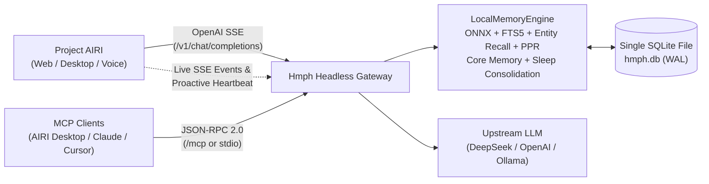

# Hmph

**Headless, single-file SQLite frontier long-term memory for [Project AIRI](https://github.com/moeru-ai/airi) and MCP agents.**

<p>
  <strong>English</strong> | <a href="README_CN.md">简体中文</a>
</p>

[](https://www.python.org/)
[](LICENSE)
[](docs/architecture.md)
[](integrations/airi/README.md)

Hmph gives AI companions and local agents durable, evolving long-term memory **without Docker, Postgres, Neo4j, or a custom frontend fork**. Point AIRI's OpenAI-Compatible provider at `http://127.0.0.1:8018/v1` (or mount Hmph via MCP) and every character gets isolated, bi-temporal, self-consolidating memory stored in one portable `.db` file.

---

## Why Hmph?

- **Zero-Infrastructure Single File**: One WAL-mode SQLite file stores verbatim transcripts, FTS5 full-text indices, 384-dim offline ONNX embeddings, a bipartite associative graph, session summaries, and Core Memory blocks.
- **Native Project AIRI Integration**: Drop-in OpenAI-compatible streaming gateway (`POST /v1/chat/completions`) that preserves 100% of AIRI's Live2D/VRM system prompt, emotion tags, and TTS latency budget (`20–31 ms` local recall).
- **Multi-Character Namespace Isolation**: Switch `model` to `hmph/yuki` or `hmph/airi` (or pass `X-Hmph-Namespace`) for strict per-character memory isolation inside one database.
- **Bi-Temporal State Evolution**: Tracks `create`, `reschedule`, `update`, `pause`, `resume`, `cancel`, `complete`, `retract`, and `ambiguous` transitions with verbatim quotes instead of flat append-only text chunks.
- **Boundary-Safe Companion Cooperation**:
  - **Always-in-Context Core Memory** (`/v1/memory/core`) with strict paused-item anti-nagging guards.
  - **Live SSE Memory Event Bus** (`/v1/memory/events`) so Live2D/VRM hooks can react in real time when a promise is saved or updated.
  - **Proactive Check-In API** (`/v1/companion/proactive`) that surfaces due commitments and open ambiguities while strictly excluding paused or retracted plans.
- **Dual-Transport MCP (8 Tools)**: Connect AIRI Desktop (Tauri MCP), Claude Desktop, or Cursor over stdio (`hmph local-mcp`) or Streamable HTTP (`POST /mcp`).
- **Atomic Zero-Resurrection Forgetting**: Forgetting an item or utterance cascades cleanly across versions, verbatim turns, graph edges, vectors, summaries, consolidations, and Core Memory in one transaction.

---

## Architecture



Read the full technical deep dive in [docs/architecture.md](docs/architecture.md).

---

## 30-Second Quickstart (Project AIRI)

### 1. Install

```bash
git clone https://github.com/<your-org>/hmph.git
cd hmph
pip install -e ".[embeddings]"
```

> Without `[embeddings]`, Hmph still runs with zero native dependencies using FTS5 + hashing vectors (or an OpenAI-compatible embedding endpoint).

### 2. Configure Your Upstream LLM

Copy `.env.example` to `.env.local` and set your provider key:

```bash
cp .env.example .env.local
```

```env
HMPH_DEEPSEEK_API_KEY=sk-your-key
HMPH_DEEPSEEK_BASE_URL=https://api.deepseek.com/v1
HMPH_DEEPSEEK_MODEL=deepseek-chat
```

*(Works with DeepSeek, OpenAI, OpenRouter, Ollama, or any OpenAI-compatible API via `HMPH_LOCAL_API_KEY`, `HMPH_LOCAL_BASE_URL`, and `HMPH_LOCAL_MODEL`.)*

### 3. Start the Headless AIRI Gateway

```bash
hmph airi-gateway --db data/hmph.db --port 8018
```

### 4. Connect Project AIRI

In **AIRI → Settings → Providers → OpenAI Compatible**:

| Setting | Value |
| :--- | :--- |
| **Base URL** | `http://127.0.0.1:8018/v1` |
| **API Key** | `local-hmph` *(any non-empty string; your real key stays local)* |
| **Model** | `hmph` · `hmph/yuki` *(per-character namespace)* · `hmph/yuki@deepseek-chat` |

See [integrations/airi/README.md](integrations/airi/README.md) for custom headers (`X-Hmph-Namespace`, `X-Hmph-Session-Id`, `X-Hmph-Memory-Mode`), SSE Live2D hooks, and proactive check-ins.

---

## MCP Server (8 Tools)

Mount Hmph in AIRI Desktop, Claude Desktop, or Cursor using [integrations/airi/mcp-config.json](integrations/airi/mcp-config.json):

```json
{
  "mcpServers": {
    "hmph-memory": {
      "command": "hmph",
      "args": ["local-mcp", "--db", "data/hmph.db"]
    }
  }
}
```

Or talk directly to the running gateway over Streamable HTTP at `POST http://127.0.0.1:8018/mcp`.

Exposed MCP tools:
- `hmph_remember` — Store verbatim text and run bi-temporal state-evolution extraction
- `hmph_recall` — 6-channel hybrid recall (Core Memory + ONNX + FTS5 + Entity-Scoped + Bipartite PPR)
- `hmph_list_memories` — Inspect evolving items, consolidated insights, and open ambiguities
- `hmph_forget` — Atomic cascade-forget by ID, message ID, or keyword
- `hmph_consolidate` — Trigger Map-Reduce Sleep Consolidation
- `hmph_graph` — Inspect the entity–item–message associative graph
- `hmph_toggle_pause` — Pause or resume reminders on any item
- `hmph_core_memory` — Read, update, or delete always-in-context Core Memory blocks

---

## HTTP API Overview

| Endpoint | Purpose |
| :--- | :--- |
| `POST /v1/chat/completions` | OpenAI-compatible streaming & non-streaming proxy with memory injection |
| `GET /v1/models` | Lists available `hmph` and `hmph/<namespace>` model routes |
| `POST /mcp` | Streamable HTTP MCP JSON-RPC 2.0 endpoint |
| `GET /v1/memory/items` | List evolving state items and full version histories |
| `POST /v1/memory/recall` | Inspect raw hybrid retrieval evidence and latency |
| `POST /v1/memory/forget` | Atomically cascade-forget items or source utterances |
| `POST /v1/memory/consolidate` | Run Map-Reduce Sleep Consolidation |
| `POST /v1/memory/summarize` | Generate coreference-resolved session summaries |
| `GET/PUT/DELETE /v1/memory/core` | Manage always-in-context Core Memory blocks |
| `GET /v1/memory/events` | Real-time SSE stream (`item_updated`, `ambiguity_detected`, `memory_forgotten`, …) |
| `GET /v1/companion/proactive` | Boundary-safe proactive check-in suggestions (strictly excludes paused items) |

---

## Verified Benchmarks

Measured on a single SQLite file with offline multilingual MiniLM ONNX embeddings and `deepseek-flash`:

| Benchmark | Scope | Result |
| :--- | :--- | :--- |
| **TimlMemBench (Bilingual)** | 48 state-evolution & forgetting queries | **48 / 48 (100%)**, 0 `wrong_state` |
| **LongMemEval-S Core** | 10 temporal / multi-session / update Qs | **10 / 10 (100%)** *(Oracle: 9 / 10)* |
| **LongMemEval-S Abstention & Preference** | 4 abstention + 2 preference Qs | **6 / 6 (100%)** |
| **LoCoMo (`conv-44`, 675 turns)** | 12 multi-hop & temporal Qs | **61.5% source recall** · **8–9 / 12 (67–75%)** E2E |
| **AIRI 4-Day Companion E2E** | 7 live UX & boundary checks | **7 / 7 PASS** · **20–31 ms** local recall |

---

## Project Structure

```text
hmph/
├── .github/workflows/checks.yml   # Zero-Docker CI (ruff + pytest + CLI smoke)
├── docs/
│   └── architecture.md            # System architecture, retrieval pipeline & SQLite schema
├── integrations/
│   └── airi/
│       ├── README.md              # Step-by-step Project AIRI setup & SSE/Proactive hooks
│       └── mcp-config.json        # Ready-to-use MCP config for AIRI Desktop / Claude / Cursor
├── src/hmph/
│   ├── __init__.py                # Public Python API
│   ├── cli.py                     # CLI entrypoint (airi-gateway, local-mcp, local-chat)
│   ├── lexical.py                 # Zero-dependency bilingual (CJK + English) tokenizer
│   └── local_memory/              # Core SQLite engine, hybrid retrieval, gateway & MCP server
├── tests/
│   ├── test_airi_gateway.py       # OpenAI proxy, SSE, Core Memory, proactive & MCP HTTP tests
│   ├── test_local_frontier.py     # Consolidation, entity recall, PPR & abstention tests
│   └── test_local_memory.py       # Bi-temporal state transitions & cascade forget tests
├── .env.example
├── LICENSE
├── pyproject.toml
├── README.md
└── README_CN.md
```

---

## Development

```bash
pip install -e ".[dev]"
ruff check .
pytest -q
```

---

## License

Released under the [MIT License](LICENSE).
