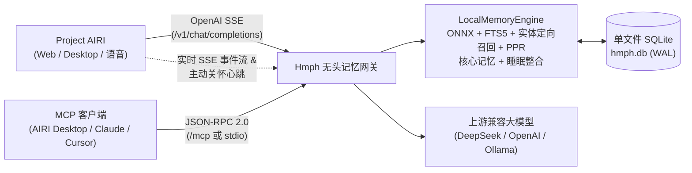

# Hmph

**供 [Project AIRI](https://github.com/moeru-ai/airi) 和 MCP 智能体使用的本地记忆后端。**

<p>
  <a href="README.md">English</a> | <strong>简体中文</strong>
</p>

[](https://www.python.org/)
[](LICENSE)
[](docs/architecture.md)
[](integrations/airi/README.md)

Hmph 用一个 SQLite 数据库保存可跨会话使用的记忆。你把周六的练琴计划改到周一，当前安排会更新，原话和旧安排仍可查。角色和交互界面由 AIRI 提供。

## 核心功能

- 按事项记录计划和偏好的变化，每次变更都可追溯到原话。对话可以分别询问现状、变更和历史。
- 结合全文、向量和关联记录找回证据，每轮只把相关内容送给模型。
- 后台按接收顺序处理新消息。单条提取结果反复无法解析时，队列会隔离该消息并继续处理后续消息。
- 提供流式聊天网关和 MCP 工具。角色可使用独立命名空间，记忆可导出为 JSON 或 Markdown。

## 系统架构



完整架构设计、六通道混合检索与 SQLite 表结构请参阅 [docs/architecture.md](docs/architecture.md)。

---

## 快速接入 Project AIRI

使用 Python 3.12 或 3.13。可以克隆仓库，也可以从 GitHub 下载源码包。

```bash
git clone https://github.com/knoci/Hmph.git
cd Hmph
python -m pip install .
```

如需可选的本地向量编码依赖，使用 `python -m pip install ".[embeddings]"`。基础安装可使用全文检索和哈希向量。

### 配置上游模型

将 `.env.example` 复制为 `.env.local`，填入模型服务的密钥和模型名。以下以 DeepSeek Flash 为例。

```env
HMPH_DEEPSEEK_API_KEY=your-key
HMPH_DEEPSEEK_MODEL=deepseek-flash
```

**接入其他模型**

在 `.env.local` 中同时设置下面三个变量，再重启 Hmph。密钥和支持 Chat Completions 的模型 ID 要来自同一服务。以下以已下载模型的 Ollama 为例：

```env
HMPH_LOCAL_API_KEY=ollama
HMPH_LOCAL_BASE_URL=http://127.0.0.1:11434/v1
HMPH_LOCAL_MODEL=qwen3:8b
```

- **自建模型**：填写服务的 OpenAI 兼容地址和实际部署的模型名。vLLM 的模型需要有聊天模板。[Ollama 文档](https://docs.ollama.com/api/openai-compatibility) · [vLLM 文档](https://docs.vllm.ai/en/latest/serving/online_serving/)
- **Gemini API**：地址用 `https://generativelanguage.googleapis.com/v1beta/openai/`。[Google 文档](https://ai.google.dev/gemini-api/docs/openai)
- **Claude API**：地址用 `https://api.anthropic.com/v1`，使用已绑定工作区的 API Key。Hmph 使用 Claude 的默认采样参数，并在本地校验抽取 JSON。[Anthropic 文档](https://platform.claude.com/docs/en/cli-sdks-libraries/libraries/openai-sdk)
- **Grok API**：地址用 `https://api.x.ai/v1`，选择该接口提供的 Chat Completions 模型。[xAI 文档](https://docs.x.ai/developers/rest-api-reference/inference/chat-completions)

AIRI 继续连接 Hmph，Model 可以填 `hmph`。每个 Hmph 进程使用一个上游地址和密钥。换模型后，先验证流式回复和一次完整的记忆保存、更新、召回。

`HMPH_LOCALE=auto` 按当前对话选择中英文记忆提示，CLI 默认为英文。设为 `en` 或 `zh` 可以固定两者的语言。`HMPH_SOURCE_TIMEZONE` 独立设置解释相对日期时使用的时区。

DeepSeek Flash 已通过网关完成中英文真实模型联调。Ollama、vLLM、Gemini、Claude 和 Grok 使用模拟上游响应验证接入。Unicode 分词和可选的多语言编码器也支持假名、韩文、西里尔字母和带重音符号的拉丁字母等文字。

打开使用旧全文索引的数据库时，Hmph 会从已存记录重建索引，并在启用哈希向量后端时刷新旧向量。单条消息连续三次返回无效结构后会被隔离，队列继续处理后续消息。上游服务故障时，消息保持待处理。

### 启动网关

```bash
hmph airi-gateway --db data/hmph.db --port 8018
```

### 连接 AIRI

打开 **AIRI → Settings → Providers → OpenAI Compatible**：

| 配置项 | 填写内容 |
| :--- | :--- |
| **Base URL** | `http://127.0.0.1:8018/v1` |
| **API Key** | 本机网关未启用认证时填 `local-hmph`。启用认证后填网关密钥。 |
| **Model** | 从下表按需选择（在 AIRI 中可手动输入，或点刷新列表直接选 `hmph`） |

**`Model` 字段填法与区别**（用于同时指定「记忆隔离空间」和「上游推理模型」）：

| Model 填法 | 记忆命名空间 | 实际调用的上游模型 | 适用场景 |
| :--- | :--- | :--- | :--- |
| `hmph` | `default`（默认空间） | `.env.local` 中配置的默认模型 | **最简单**，只养一个 AIRI 伴侣时直接填它 |
| `hmph/<角色名>`<br>*(例：`hmph/yuki`、`hmph/airi`)* | `<角色名>`（独立隔离空间） | `.env.local` 中配置的默认模型 | **多角色隔离**：同一个 `.db` 文件里养多个角色，彼此记忆完全不串台 |
| `hmph/<角色名>@<上游模型>`<br>*(例：`hmph/yuki@deepseek-flash`)* | `<角色名>`（独立隔离空间） | `@` 后指定的模型 | **按角色切换模型**：无需重启网关，给不同角色/配置临时指定不同上游模型 |
| 直接填上游模型名<br>*(例：`deepseek-flash`、`gpt-4o-mini`)* | `default`（若传 `X-Hmph-Namespace` 则以请求头为准） | 你填写的该上游模型 | 兼容只填原生模型名的客户端，同时保持默认记忆开启 |

> 注：前缀也兼容 `hmph:<角色名>` 与 `airi/<角色名>`；若请求中同时带有 `X-Hmph-Namespace` 请求头，以请求头为准。

### 试一次改期

先告诉 AIRI「我周六练琴」，再说「练琴改到周一」。在同一个记忆空间里开新会话，问「我现在约的是哪天练琴？」预期回答是周一。可用 `GET /v1/memory` 查事项状态，用 `POST /v1/memory/recall` 核对召回的证据。

自定义请求头（`X-Hmph-Namespace`、`X-Hmph-Session-Id`、`X-Hmph-Memory-Mode`）、Live2D SSE 事件订阅与主动关怀心跳接入示例请见 [integrations/airi/README.md](integrations/airi/README.md)。

---

## MCP 服务（8 个标准工具）

可直接使用 [integrations/airi/mcp-config.json](integrations/airi/mcp-config.json) 将 Hmph 挂载至 AIRI Desktop、Claude Desktop 或 Cursor：

```json
{
  "mcpServers": {
    "hmph-memory": {
      "command": "hmph",
      "args": ["local-mcp", "--db", "data/hmph.db"]
    }
  }
}
```

如果 `hmph airi-gateway` 已在运行，也可以直接通过 Streamable HTTP 调用 `POST http://127.0.0.1:8018/mcp`。

内置 8 个 MCP 工具：
- `hmph_remember` — 保存用户原话并抽取记忆变化
- `hmph_recall` — 六通道混合召回（Core Memory + ONNX + FTS5 + 实体定向召回 + 二分 PPR）
- `hmph_list_memories` — 查看演化记忆事项、整合洞察与未决指代疑点
- `hmph_forget` — 按 ID、消息 ID 或关键词执行零复活原子级联遗忘
- `hmph_consolidate` — 手动触发 Map-Reduce 睡眠整合
- `hmph_graph` — 查看实体—事项—消息二分联想图谱
- `hmph_toggle_pause` — 暂停或恢复指定事项的提醒状态
- `hmph_core_memory` — 读取、更新或删除常驻上下文核心记忆块

---

## HTTP 接口一览

| 接口 | 用途 |
| :--- | :--- |
| `POST /v1/chat/completions` | OpenAI 兼容流式/非流式对话代理，透明注入 `<hmph_memory>` |
| `GET /v1/models` | 列出可用的 `hmph` 与 `hmph/<namespace>` 模型路由 |
| `POST /mcp` | Streamable HTTP MCP JSON-RPC 2.0 端点 |
| `GET /v1/memory` | 查看事项、版本记录和未解决的指代疑点 |
| `GET /v1/memory/as-of` | 基于当前掌握的记录，按生效日期查询历史状态 |
| `GET /v1/memory/export` | 将指定角色记忆导出为可读的 Markdown 或 JSON |
| `POST /v1/memory/import` | 将 JSON 记忆快照幂等导入至指定角色命名空间 |
| `POST /v1/memory/recall` | 调试混合检索证据链与本地延迟（支持可选 `as_of`） |
| `GET /v1/memory/extractions` | 列出指定命名空间内被隔离的抽取失败消息 |
| `POST /v1/memory/extractions/{message_id}/retry` | 重试隔离消息。若更新的原话已改变该事项，返回 HTTP 409 |
| `POST /v1/memory/forget` | 原子级联遗忘指定事项或原话 |
| `POST /v1/memory/consolidate` | 触发 Map-Reduce 睡眠整合 |
| `POST /v1/memory/summarize` | 生成消解指代后的会话情景摘要 |
| `GET /v1/memory/core` | 查看核心记忆块 |
| `PUT/DELETE /v1/memory/core/{block_key}` | 更新或删除指定核心记忆块 |
| `GET /v1/memory/events` | 实时 SSE 记忆事件流（`item_updated`、`ambiguity_detected`、`memory_forgotten` 等） |
| `GET /v1/companion/proactive` | 边界安全的主动关怀建议（严格排除已暂停事项） |

---

## 评测记录

以下是项目用离线多语言 MiniLM 向量和 `deepseek-flash` 测过的选定子集。本地召回耗时与模型生成耗时分开计算。

| 评测基准 | 评测范围 | 实测结果 |
| :--- | :--- | :--- |
| **TimlMemBench（中英双语）** | 48 道状态演化与遗忘题 | **48 / 48 (100%)**，0 次 `wrong_state` |
| **LongMemEval-S 核心集** | 10 道跨会话 / 时序 / 知识更新题 | **10 / 10 (100%)** *（单轮 Oracle 基线为 9 / 10）* |
| **LongMemEval-S 拒答与偏好** | 4 道拒答防幻觉 + 2 道偏好题 | **6 / 6 (100%)** |
| **LoCoMo（`conv-44`，675 轮）** | 12 道多跳与时序综合题 | **9 / 12 (75.0%)** *（跨会话推理与事实细节均 100%）* |
| **网关与向量检索** | 7 项边界/防打扰 + 万级 384 维向量缓存 | **7 / 7 全过** · 实时召回 **`~6 ms`** · 缓存检索 **`<4 ms`** |

---

## 项目结构

```text
hmph/
├── .github/workflows/checks.yml   # 静态检查、回归测试与 CLI 检查
├── docs/
│   └── architecture.md            # 系统架构、检索管线与 SQLite 表结构
├── integrations/
│   └── airi/
│       ├── README.md              # Project AIRI 接入指南与 SSE/主动关怀示例
│       └── mcp-config.json        # AIRI Desktop / Claude / Cursor 开箱即用 MCP 配置
├── src/hmph/
│   ├── __init__.py                # 公共 Python API
│   ├── cli.py                     # CLI 入口（airi-gateway、local-mcp、local-chat、export/import）
│   ├── lexical.py                 # Unicode 分词器
│   └── local_memory/              # 核心 SQLite 引擎、混合检索、网关与 MCP 服务
├── tests/                         # 记忆、旧库迁移和网关回归测试
├── .env.example
├── LICENSE
├── pyproject.toml
├── README.md
└── README_CN.md
```

---

## 本地开发与检查

```bash
pip install -e ".[dev]"
ruff check .
python -m compileall -q src
python -m unittest discover -s tests
hmph --help
```

---

## 开源协议

基于 [MIT License](LICENSE) 开源发布。
