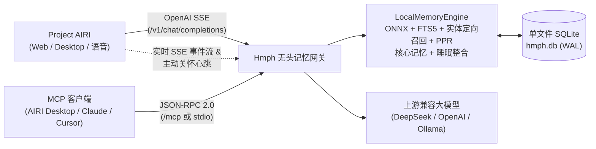

# Hmph

**面向 [Project AIRI](https://github.com/moeru-ai/airi) 与 MCP 智能体的无头、单文件 SQLite 前沿长期记忆组件。**

<p>
  <a href="README.md">English</a> | <strong>简体中文</strong>
</p>

[](https://www.python.org/)
[](LICENSE)
[](docs/architecture.md)
[](integrations/airi/README.md)

Hmph 为 AI 伴侣与本地智能体提供持久、可演化的长期记忆——**无需 Docker、Postgres、Neo4j，也无需魔改前端源码**。只需将 AIRI 的 OpenAI 兼容服务地址指向 `http://127.0.0.1:8018/v1`（或通过 MCP 挂载），每个角色即可在同一份便携式 `.db` 文件中拥有严格隔离、双时态演化且会自动睡眠整合的长期记忆。

---

## 核心特性

- **零运维单文件架构**：单份 WAL 模式 SQLite 文件统一承载原始对话记录、FTS5 全文索引、384 维离线多语言 ONNX 向量、二分联想图谱、会话摘要与核心记忆块。
- **Project AIRI 原生直连**：开箱即用的 OpenAI 兼容流式网关（`POST /v1/chat/completions`），100% 保留 AIRI 的 Live2D/VRM 人设提示词、情绪标签与实时语音循环（本地检索耗时仅 `20–31 ms`）。
- **多角色命名空间严格隔离**：将 `model` 设为 `hmph/yuki`、`hmph/airi`（或传入 `X-Hmph-Namespace` 请求头），即可在同一个数据库内为不同角色彻底隔离记忆、图谱与事件流。
- **双时态状态演化账本**：不只是追加碎片文本，而是显式追踪 `create`、`reschedule`、`update`、`pause`、`resume`、`cancel`、`complete`、`retract` 与 `ambiguous` 等状态迁移，并完整保留原话引文与时间锚点。
- **懂分寸的伴侣深度协同**：
  - **常驻上下文核心记忆（Core Memory）**（`/v1/memory/core`）：严格内置“已暂停计划防打扰”守卫。
  - **实时 SSE 记忆事件总线**（`/v1/memory/events`）：当承诺被记下或更新时实时推送，便于 AIRI Live2D/VRM 触发点头、害羞等微表情反馈。
  - **边界安全的主动关怀接口**（`/v1/companion/proactive`）：仅针对未决指代与到期活跃约定生成温和提醒，严格排除已暂停、已取消或已撤回事项。
- **双传输协议 MCP 服务（8 个工具）**：支持 stdio（`hmph local-mcp`）与 Streamable HTTP（`POST /mcp`），可直接接入 AIRI Desktop（Tauri MCP）、Claude Desktop 或 Cursor。
- **零复活原子级联遗忘**：按事项 ID、原话 ID 或关键词一键遗忘，在单个 SQLite 事务内同步清除版本链、关联原话与回复、图边、向量、会话摘要、睡眠整合洞察与 Core Memory 引用。

---

## 系统架构



完整架构设计、六通道混合检索与 SQLite 表结构请参阅 [docs/architecture.md](docs/architecture.md)。

---

## 30 秒快速上手（接入 Project AIRI）

### 1. 安装

```bash
git clone https://github.com/<your-org>/hmph.git
cd hmph
pip install -e ".[embeddings]"
```

> 不安装 `[embeddings]` 亦可零原生依赖运行，系统会自动退化为 FTS5 + 哈希向量（或使用你配置的云端/本地 Embedding 接口）。

### 2. 配置上游模型

复制 `.env.example` 为 `.env.local` 并填入你的 API Key：

```bash
cp .env.example .env.local
```

```env
HMPH_DEEPSEEK_API_KEY=sk-your-key
HMPH_DEEPSEEK_BASE_URL=https://api.deepseek.com/v1
HMPH_DEEPSEEK_MODEL=deepseek-chat
```

*（同时支持 DeepSeek、OpenAI、OpenRouter、Ollama 及任意 OpenAI 兼容接口，可通过 `HMPH_LOCAL_API_KEY`、`HMPH_LOCAL_BASE_URL`、`HMPH_LOCAL_MODEL` 覆盖。）*

### 3. 启动无头 AIRI 记忆网关

```bash
hmph airi-gateway --db data/hmph.db --port 8018
```

### 4. 连接 Project AIRI

打开 **AIRI → Settings → Providers → OpenAI Compatible**：

| 配置项 | 填写内容 |
| :--- | :--- |
| **Base URL** | `http://127.0.0.1:8018/v1` |
| **API Key** | `local-hmph` *（任意非空字符串即可，真实密钥安全保存在本地 Hmph 进程）* |
| **Model** | 从下表按需选择（在 AIRI 中可手动输入，或点刷新列表直接选 `hmph`） |

**`Model` 字段填法与区别**（用于同时指定「记忆隔离空间」和「上游推理模型」）：

| Model 填法 | 记忆命名空间 | 实际调用的上游模型 | 适用场景 |
| :--- | :--- | :--- | :--- |
| `hmph` | `default`（默认空间） | `.env.local` 中配置的默认模型 | **最简单**，只养一个 AIRI 伴侣时直接填它 |
| `hmph/<角色名>`<br>*(例：`hmph/yuki`、`hmph/airi`)* | `<角色名>`（独立隔离空间） | `.env.local` 中配置的默认模型 | **多角色隔离**：同一个 `.db` 文件里养多个角色，彼此记忆完全不串台 |
| `hmph/<角色名>@<上游模型>`<br>*(例：`hmph/yuki@deepseek-reasoner`)* | `<角色名>`（独立隔离空间） | `@` 后指定的模型 | **按角色切换模型**：无需重启网关，给不同角色/配置临时指定不同上游模型 |
| 直接填上游模型名<br>*(例：`deepseek-chat`、`gpt-4o-mini`)* | `default`（若传 `X-Hmph-Namespace` 则以请求头为准） | 你填写的该上游模型 | 兼容只填原生模型名的客户端，同时保持默认记忆开启 |

> 注：前缀也兼容 `hmph:<角色名>` 与 `airi/<角色名>`；若请求中同时带有 `X-Hmph-Namespace` 请求头，以请求头为准。

自定义请求头（`X-Hmph-Namespace`、`X-Hmph-Session-Id`、`X-Hmph-Memory-Mode`）、Live2D SSE 事件订阅与主动关怀心跳接入示例请见 [integrations/airi/README.md](integrations/airi/README.md)。

---

## MCP 服务（8 个标准工具）

可直接使用 [integrations/airi/mcp-config.json](integrations/airi/mcp-config.json) 将 Hmph 挂载至 AIRI Desktop、Claude Desktop 或 Cursor：

```json
{
  "mcpServers": {
    "hmph-memory": {
      "command": "hmph",
      "args": ["local-mcp", "--db", "data/hmph.db"]
    }
  }
}
```

如果 `hmph airi-gateway` 已在运行，也可以直接通过 Streamable HTTP 调用 `POST http://127.0.0.1:8018/mcp`。

内置 8 个 MCP 工具：
- `hmph_remember` — 写入用户原话并执行双时态状态演化抽取
- `hmph_recall` — 六通道混合召回（Core Memory + ONNX + FTS5 + 实体定向召回 + 二分 PPR）
- `hmph_list_memories` — 查看演化记忆事项、整合洞察与未决指代疑点
- `hmph_forget` — 按 ID、消息 ID 或关键词执行零复活原子级联遗忘
- `hmph_consolidate` — 手动触发 Map-Reduce 睡眠整合
- `hmph_graph` — 查看实体—事项—消息二分联想图谱
- `hmph_toggle_pause` — 暂停或恢复指定事项的提醒状态
- `hmph_core_memory` — 读取、更新或删除常驻上下文核心记忆块

---

## HTTP 接口一览

| 接口 | 用途 |
| :--- | :--- |
| `POST /v1/chat/completions` | OpenAI 兼容流式/非流式对话代理，透明注入 `<hmph_memory>` |
| `GET /v1/models` | 列出可用的 `hmph` 与 `hmph/<namespace>` 模型路由 |
| `POST /mcp` | Streamable HTTP MCP JSON-RPC 2.0 端点 |
| `GET /v1/memory/items` | 查询演化事项与完整版本历史 |
| `POST /v1/memory/recall` | 调试混合检索证据链与本地延迟 |
| `POST /v1/memory/forget` | 原子级联遗忘指定事项或原话 |
| `POST /v1/memory/consolidate` | 触发 Map-Reduce 睡眠整合 |
| `POST /v1/memory/summarize` | 生成消解指代后的会话情景摘要 |
| `GET/PUT/DELETE /v1/memory/core` | 管理常驻上下文 Core Memory 记忆块 |
| `GET /v1/memory/events` | 实时 SSE 记忆事件流（`item_updated`、`ambiguity_detected`、`memory_forgotten` 等） |
| `GET /v1/companion/proactive` | 边界安全的主动关怀建议（严格排除已暂停事项） |

---

## 实测基准表现

全部数据均在单文件 SQLite + 离线多语言 MiniLM ONNX 向量 + `deepseek-flash` 真实推理下测得：

| 评测基准 | 评测范围 | 实测结果 |
| :--- | :--- | :--- |
| **TimlMemBench（中英双语）** | 48 道状态演化与遗忘题 | **48 / 48 (100%)**，0 次 `wrong_state` |
| **LongMemEval-S 核心集** | 10 道跨会话 / 时序 / 知识更新题 | **10 / 10 (100%)** *（单轮 Oracle 基线为 9 / 10）* |
| **LongMemEval-S 拒答与偏好** | 4 道拒答防幻觉 + 2 道偏好题 | **6 / 6 (100%)** |
| **LoCoMo（`conv-44`，675 轮）** | 12 道多跳与时序综合题 | **61.5% 原话召回率** · **8–9 / 12 (67–75%)** 端到端正确率 |
| **AIRI 4 天真实陪伴端到端压测** | 7 项延迟、防打扰与遗忘不变量 | **7 / 7 全过** · 本地检索 **20–31 ms** |

---

## 项目结构

```text
hmph/
├── .github/workflows/checks.yml   # 零 Docker CI（ruff + pytest + CLI 冒烟）
├── docs/
│   └── architecture.md            # 系统架构、检索管线与 SQLite 表结构
├── integrations/
│   └── airi/
│       ├── README.md              # Project AIRI 接入指南与 SSE/主动关怀示例
│       └── mcp-config.json        # AIRI Desktop / Claude / Cursor 开箱即用 MCP 配置
├── src/hmph/
│   ├── __init__.py                # 公共 Python API
│   ├── cli.py                     # CLI 入口（airi-gateway、local-mcp、local-chat）
│   ├── lexical.py                 # 零依赖中英双语分词器
│   └── local_memory/              # 核心 SQLite 引擎、混合检索、网关与 MCP 服务
├── tests/
│   ├── test_airi_gateway.py       # OpenAI 代理、SSE、Core Memory、主动关怀与 MCP HTTP 测试
│   ├── test_local_frontier.py     # 睡眠整合、实体召回、PPR 与拒答测试
│   └── test_local_memory.py       # 双时态状态迁移与级联遗忘测试
├── .env.example
├── LICENSE
├── pyproject.toml
├── README.md
└── README_CN.md
```

---

## 本地开发与测试

```bash
pip install -e ".[dev]"
ruff check .
pytest -q
```

---

## 开源协议

基于 [MIT License](LICENSE) 开源发布。
