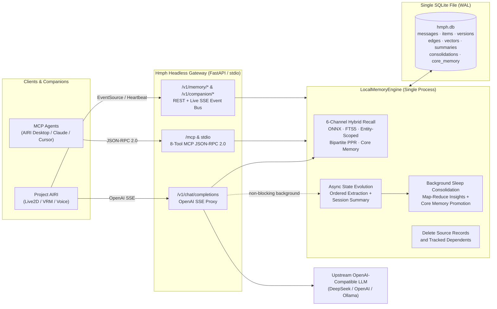

# Hmph Architecture

Hmph is a single-process memory engine for [Project AIRI](https://github.com/moeru-ai/airi) and MCP clients. It keeps versioned memory, conversation records, and search indexes in SQLite and adds relevant context to each upstream chat request.

---

## 1. System Topology

---

## 2. Core Design Principles

1. **Zero-Fork Companion Cooperation**:
   - AIRI supplies the character prompt and handles voice and animation.
   - Hmph injects a compact `<hmph_memory>` block without altering the character persona, forwards upstream SSE chunks, and handles extraction, session summarization, and sleep consolidation asynchronously in the background.
   - Built-in 20-second retry idempotency prevents duplicate writes if a voice client retries on network hiccups.
2. **Multi-Character Namespace Isolation**:
   - A single `hmph.db` hosts strictly isolated namespaces via `model: "hmph/<character>"`, `hmph/<character>@<upstream_model>`, or `X-Hmph-Namespace`.
   - Every SQL query, vector scan, PPR walk, session summary, core memory block, SSE stream, and cascade forget is scoped to `(namespace)`.
3. **Versioned state and source order**
   - Tracked commitments, plans, preferences, and constraints are stored as versioned items (`items` and `item_versions`), recording explicit transitions: `create`, `reschedule`, `update`, `pause`, `resume`, `cancel`, `complete`, `retract`, and `ambiguous`.
   - Every version carries its verbatim `source_quote`, `source_message_id`, and `effective_time_text`.
   - A SQLite trigger assigns a durable receipt sequence in `message_ingest_order`. The worker processes each namespace in receipt order. The write transaction applies a source once and rolls back an older source that would replace a newer state.
   - Startup resumes pending extraction. Malformed output is counted and quarantined after three structural failures. Provider errors leave the message pending for recovery.
   - The `as_of` query selects versions by their effective start date from records available now. A correction received later can affect earlier dates.
4. **Boundary-Safe Anti-Nagging**:
   - Items marked `paused`, `cancelled`, or `retracted` are excluded from proactive check-ins (`GET /v1/companion/proactive`), suppressed from normal chat reminders, and stripped from Core Memory and consolidated insights via strict provenance checks (`any(hidden_paused)`).
5. **Cascade deletion**
   - A SQLite transaction deletes the selected source and tracked dependents, including associated indexes. Deleting one source can leave the item and its other versions in place. A core block linked only to that surviving item can still contain a detail from the deleted revision.

---

## 3. Retrieval pipeline

On a chat turn, Hmph assembles context from these retrieval channels. The embedding service is configurable.

1. **Always-in-Context Core Memory**: Compact Letta-style persona/user blocks (`core_memory_blocks`), filtered against paused-item provenance.
2. **Dense Semantic Search**: Offline 384-dim `paraphrase-multilingual-MiniLM-L12-v2` ONNX embeddings (or OpenAI-compatible embeddings) using NumPy vectorized cosine top-k over messages, items, session summaries, and consolidated insights.
3. **Lexical BM25 (SQLite FTS5)**: Unicode tokenization (`src/hmph/lexical.py`) over verbatim messages, version summaries, and session summaries, augmented with deterministic relative-date tokens.
4. **HippoRAG-2 Heterogeneous Personalized PageRank**: Multi-hop walk across `entity ↔ item ↔ session_summary ↔ message` nodes with inverse-degree (IDF) entity specificity scaling and A-MEM Zettelkasten dynamic cross-links (`RELATED_ENTITY`), running on both benchmark and live AIRI chat paths.
5. **IDF-Weighted Entity-Scoped & Cue-Triggered Recall**: Automatically activates associative recall even on declarative statements without question marks when known entities or strong semantic cues fire, while skipping pure backchannels (`"ok"`, `"哈哈"`).
6. **Reciprocal Rank Fusion (RRF) + ACT-R Cognitive Activation + Feature Reranker**: Merges all channels, reinforces accessed items (`access_count` + power-law decay), caches L2-normalized Float32 matrices in memory (`<5 ms` across 10k+ vectors).

---

## 4. Background Memory Consolidation

- **Coreference-Resolved Session Summaries**: Triggered automatically on session switches or every 6 user turns (`POST /v1/memory/summarize` for manual runs). Resolves pronouns (`"he"`, `"my partner"`, `"last Friday"`) against session timestamps into standalone atomic facts.
- **Uncapped Map-Reduce Sleep Consolidation**: Runs asynchronously every `N` turns (default `12`) or via `POST /v1/memory/consolidate`. Batches active items and recent summaries into vector-indexed higher-order user insights (`consolidations`) and automatically promotes durable user profile facts into `core_memory_blocks`.

---

## 5. SQLite Schema Overview

All tables live in one WAL-mode SQLite file (`hmph.db`):

| Table | Purpose |
| :--- | :--- |
| `messages` + `messages_fts` | Verbatim user/assistant utterances, timestamps, session IDs, namespace, and FTS5 index |
| `items` and `item_versions` | Current state and version history with source quotes |
| `ambiguities` | Open unresolved references awaiting gentle clarification |
| `memory_edges` | Stored relationships and provenance links |
| `embeddings` and derived embedding tables | Packed float32 vectors for retrieval |
| `session_summaries` | Coreference-resolved per-session episodic digests |
| `consolidations` | Map-Reduce sleep-consolidated cross-session insights |
| `core_memory_blocks` | Always-in-context character/user profile blocks with source citations |

---

## 6. Verified Benchmarks

All numbers below were measured against real upstream LLM inference (`deepseek-flash`) with offline multilingual MiniLM ONNX embeddings on a single SQLite file:

| Benchmark / Suite | Scope | Result | Key Takeaway |
| :--- | :--- | :--- | :--- |
| **TimlMemBench (Bilingual)** | 48 state-evolution queries | **48 / 48 (100%)**, 0 `wrong_state` | Exact tracking across create, reschedule, pause, resume, retract, and forget |
| **LongMemEval-S Core** | 10 multi-session / temporal / update Qs | **10 / 10 (100%)** | Outperforms single-pass Oracle baseline (9 / 10) |
| **LongMemEval-S Abstention & Preference** | 4 abstention + 2 preference Qs | **6 / 6 (100%)** | Zero-hallucination abstention & grounded preference recall |
| **LoCoMo (`conv-44`)** | 675 turns, 12 multi-hop & temporal Qs | **9 / 12 (75.0%)** (Cat 3 & Cat 4: 100%) | >2× source recall vs. TiMem+Mem0 baseline (30.0%) at ~38% write cost |
| **Gateway and vector search** | 7 UX/boundary checks + 5k–10k cached 384d vectors | **7 / 7 PASS**, **~6 ms** live recall (`<4 ms` cached) | Real-time voice-safe retrieval with paused-plan checks in the selected cases |
