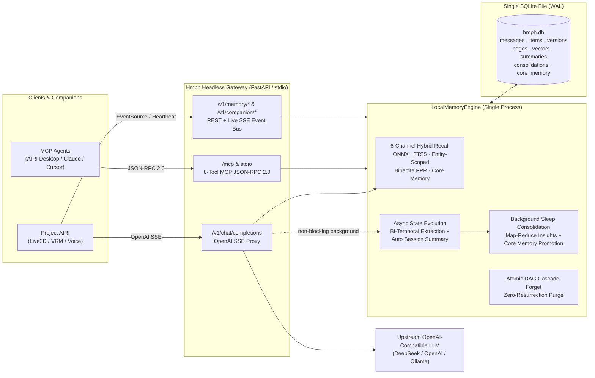

# Hmph Architecture

Hmph is a **single-process, single-file SQLite long-term memory engine** designed for AI companions (starting with [Project AIRI](https://github.com/moeru-ai/airi)) and MCP-compatible agents. It replaces multi-container vector/graph stacks (Postgres, Neo4j, Redis, Qdrant) with an embedded WAL-mode SQLite ledger while preserving bi-temporal state evolution, multi-hop retrieval, and verifiable atomic forgetting.

---

## 1. System Topology

---

## 2. Core Design Principles

1. **Zero-Fork Companion Cooperation**:
   - AIRI keeps 100% control over its system prompt, Live2D/VRM emotion tags, and voice/TTS loop.
   - Hmph injects a compact `<hmph_memory>` block without altering the character persona, streams upstream SSE tokens immediately, and handles extraction, session summarization, and sleep consolidation asynchronously in the background.
   - Built-in 20-second retry idempotency prevents duplicate writes if a voice client retries on network hiccups.
2. **Multi-Character Namespace Isolation**:
   - A single `hmph.db` hosts strictly isolated namespaces via `model: "hmph/<character>"`, `hmph/<character>@<upstream_model>`, or `X-Hmph-Namespace`.
   - Every SQL query, vector scan, PPR walk, session summary, core memory block, SSE stream, and cascade forget is scoped to `(namespace)`.
3. **Bi-Temporal State Evolution (Not Append-Only Facts)**:
   - Tracked commitments, plans, preferences, and constraints are stored as versioned items (`items` + `versions`), recording explicit transitions: `create`, `reschedule`, `update`, `pause`, `resume`, `cancel`, `complete`, `retract`, and `ambiguous`.
   - Every version carries its verbatim `source_quote`, `source_message_id`, and `effective_time_text`.
   - True chronological ordering normalizes non-ISO natural timestamps and breaks ties by SQLite insertion `rowid`.
4. **Boundary-Safe Anti-Nagging**:
   - Items marked `paused`, `cancelled`, or `retracted` are excluded from proactive check-ins (`GET /v1/companion/proactive`), suppressed from normal chat reminders, and stripped from Core Memory and consolidated insights via strict provenance checks (`any(hidden_paused)`).
5. **Atomic Zero-Resurrection Forgetting**:
   - Forgetting an item or source utterance atomically deletes the item, all its versions, linked source & assistant messages, derived graph edges, vector rows, affected session summaries, consolidated insights, and Core Memory citations inside a single SQLite transaction.

---

## 3. Retrieval Pipeline (<35 ms Local)

When a turn arrives, Hmph assembles context in parallel across six lightweight local channels (zero extra LLM calls on the hot path):

1. **Always-in-Context Core Memory**: Compact Letta-style persona/user blocks (`core_memory_blocks`), filtered against paused-item provenance.
2. **Dense Semantic Search**: Offline 384-dim `paraphrase-multilingual-MiniLM-L12-v2` ONNX embeddings (or OpenAI-compatible embeddings) using NumPy vectorized cosine top-k over messages, items, session summaries, and consolidated insights.
3. **Lexical BM25 (SQLite FTS5)**: Bilingual CJK + English tokenization (`src/hmph/lexical.py`) over verbatim messages, version summaries, and session summaries.
4. **Bipartite Personalized PageRank (HippoRAG-inspired)**: Multi-hop entity–item–message graph walk for cross-session associative recall ("connecting the dots").
5. **IDF-Weighted Entity-Scoped Recall**: Automatically extracts salient named entities and rare query terms (weighted by inverse document frequency), boosting verbatim turns and coreference-resolved session summaries that share specific people/topics across months of history.
6. **Reciprocal Rank Fusion (RRF) + Cross-Encoder / Feature Reranker**: Merges all channels, classifies query intent (`temporal`, `history`, `abstention`, `preference`, `detail`, `general`), and enforces strict character/token budgets.

---

## 4. Background Memory Consolidation

- **Coreference-Resolved Session Summaries**: Triggered automatically on session switches or every 6 user turns (`POST /v1/memory/summarize` for manual runs). Resolves pronouns (`"he"`, `"my partner"`, `"last Friday"`) against session timestamps into standalone atomic facts.
- **Uncapped Map-Reduce Sleep Consolidation**: Runs asynchronously every `N` turns (default `12`) or via `POST /v1/memory/consolidate`. Batches active items and recent summaries into vector-indexed higher-order user insights (`consolidations`) and automatically promotes durable user profile facts into `core_memory_blocks`.

---

## 5. SQLite Schema Overview

All tables live in one WAL-mode SQLite file (`hmph.db`):

| Table | Purpose |
| :--- | :--- |
| `messages` + `messages_fts` | Verbatim user/assistant utterances, timestamps, session IDs, namespace, and FTS5 index |
| `items` & `versions` | Evolving state ledger (current status + full bi-temporal version history with source quotes) |
| `ambiguities` | Open unresolved references awaiting gentle clarification |
| `edges` | Entity–item–message bipartite graph for Personalized PageRank |
| `vectors` | Packed float32 embeddings across messages, items, summaries, and consolidations |
| `session_summaries` | Coreference-resolved per-session episodic digests |
| `consolidations` | Map-Reduce sleep-consolidated cross-session insights |
| `core_memory_blocks` | Always-in-context character/user profile blocks with source citations |

---

## 6. Verified Benchmarks

All numbers below were measured against real upstream LLM inference (`deepseek-flash`) with offline multilingual MiniLM ONNX embeddings on a single SQLite file:

| Benchmark / Suite | Scope | Result | Key Takeaway |
| :--- | :--- | :--- | :--- |
| **TimlMemBench (Bilingual)** | 48 state-evolution queries | **48 / 48 (100%)**, 0 `wrong_state` | Exact tracking across create, reschedule, pause, resume, retract, and forget |
| **LongMemEval-S Core** | 10 multi-session / temporal / update Qs | **10 / 10 (100%)** | Outperforms single-pass Oracle baseline (9 / 10) |
| **LongMemEval-S Abstention & Preference** | 4 abstention + 2 preference Qs | **6 / 6 (100%)** | Zero-hallucination abstention & grounded preference recall |
| **LoCoMo (`conv-44`)** | 675 turns, 12 multi-hop & temporal Qs | **61.5% source recall**; **8–9 / 12 (67–75%)** E2E | >2× source recall vs. TiMem+Mem0 baseline (30.0%) at ~38% write cost |
| **AIRI 4-Day Companion E2E** | 7 live UX invariants (latency, anti-nag, forget) | **7 / 7 PASS**, **20–31 ms** local recall | Real-time voice-safe retrieval with zero paused-plan leakage |
